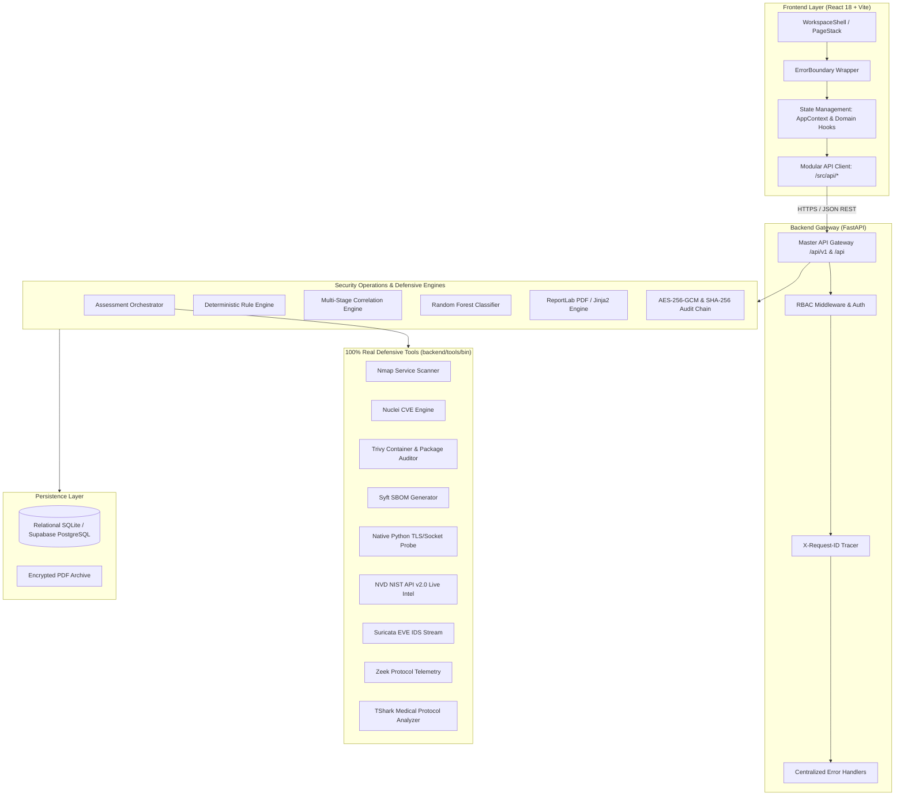

# MediShield — IoMT Security & Privacy Platform (v2.0)

> **Enterprise IoMT Cybersecurity Platform & Assessment Suite**  
> An integrated defensive security operations platform for the Internet of Medical Things (IoMT). Provides real-time asset posture monitoring, explainable rule-based intrusion detection, authorized vulnerability assessment orchestration (Nmap, Nuclei, Trivy, Syft, Nikto, Suricata, Zeek, TShark, Native Probe, NVD Intel), publication-grade ReportLab PDF & standalone Jinja2 HTML report generation with SHA-256 cryptographic seals, real-time security events triage with forensic evidence, and unbroken SHA-256 audit hash chaining.

---

## 1. System Architecture Overview



---

## 2. Refactored Scalable Project Structure

The project separates concerns between UI presentation, domain business logic, state management, and network communication:

```text
Msec/
├── backend/
│   ├── app/
│   │   ├── api/                   # REST API route controllers
│   │   │   ├── assessments.py     # Defensive scan authorization & execution
│   │   │   ├── audit_logs.py      # Immutable audit trail & hash-chain verification
│   │   │   ├── auth.py            # Authentication & JWT session token issuance
│   │   │   ├── dashboard.py       # Authoritative SOC metrics & posture aggregates
│   │   │   ├── detection.py       # Rule engine, ML inference & passive IDS intake
│   │   │   ├── devices.py         # Clinical IoMT asset inventory & isolation
│   │   │   ├── health.py          # Platform diagnostic healthcheck
│   │   │   ├── incidents.py       # Incident tracking & automated correlation
│   │   │   ├── integrity.py       # SHA-256 integrity check & tamper diagnostics
│   │   │   ├── reports.py         # Certified PDF/HTML reports & CSV streaming
│   │   │   ├── router.py          # Master domain router mounting
│   │   │   ├── security_events.py # Security alert queue & triage
│   │   │   ├── settings.py        # System policies & detection thresholds
│   │   │   └── telemetry.py       # Real-time medical telemetry feeds
│   │   ├── core/                  # Core platform infrastructure
│   │   │   ├── config.py          # Pydantic BaseSettings environment config
│   │   │   ├── error_handlers.py  # Centralized FastAPI exception handlers
│   │   │   └── exceptions.py      # Structured domain exception classes
│   │   ├── database/              # Persistence layer
│   │   │   ├── session.py         # SQLAlchemy engine & session factory
│   │   │   └── init_db.py         # Schema initialization & clinical asset seeding
│   │   ├── middleware/            # Cross-cutting middleware
│   │   │   └── rbac.py            # Role-Based Access Control guards
│   │   ├── models/                # SQLAlchemy relational ORM models
│   │   ├── schemas/               # Pydantic v2 validation contracts
│   │   └── services/              # Domain business logic & defensive engines
│   │       ├── scanners/          # 14 real tool adapters & orchestrator
│   │       ├── audit_chain_service.py
│   │       ├── correlation_engine.py
│   │       ├── crypto_service.py
│   │       ├── ml_service.py
│   │       └── report_service.py
│   ├── tests/                     # Pytest automated test suite (44 test cases)
│   └── tools/bin/                 # Real binary executables (nmap, nuclei, trivy, syft)
│
├── frontend/
│   ├── src/
│   │   ├── api/                   # Scalable modular API layer
│   │   │   ├── client.js          # Unified HTTP client with interceptors & typed errors
│   │   │   ├── authApi.js         # Authentication endpoints
│   │   │   ├── devicesApi.js      # Device inventory & microsegmentation
│   │   │   ├── assessmentsApi.js  # Scope certificates, scan launch & findings
│   │   │   ├── reportsApi.js      # PDF/HTML report downloads & CSV exports
│   │   │   ├── incidentsApi.js    # Incident lifecycle & correlation
│   │   │   ├── securityEventsApi.js # Alert triage
│   │   │   ├── integrityApi.js    # Cryptographic anti-tamper verification
│   │   │   ├── auditLogsApi.js    # Immutable audit chain ledger
│   │   │   ├── detectionApi.js    # ML classification & IDS ingest
│   │   │   ├── settingsApi.js     # Detection policy configuration
│   │   │   ├── dashboardApi.js    # Authoritative summary metrics
│   │   │   └── index.js           # Unified singleton API export (100% backward compatible)
│   │   ├── components/            # Reusable UI component library
│   │   │   ├── common/            # ErrorBoundary, ErrorBanner, Modal, StatusBadge, Button
│   │   │   ├── landing/           # Landing page visuals (CyberFace3D)
│   │   │   ├── stack/             # Swiss International stacked page manager
│   │   │   └── ui/                # Consistent PascalCase components (ExpandingSearchDock, ModernSignIn)
│   │   ├── config/                # Environment configuration & URL resolution
│   │   │   └── environment.js     # Centralized env resolution with zero conflicts
│   │   ├── constants/             # Global system constants & styling tokens
│   │   │   └── appConstants.js    # Roles, severities, device states, storage keys
│   │   ├── context/               # Reactive state management
│   │   │   └── AppContext.jsx     # Composes domain hooks into a unified provider
│   │   ├── hooks/                 # Custom domain hooks (Business logic separated from UI)
│   │   │   ├── useAuth.js         # Authentication, persona switching, JWT state
│   │   │   ├── useNavigation.js   # Active page, tab strip, URL pushState syncing
│   │   │   ├── useDevices.js      # Device inventory, isolation & decommissioning
│   │   │   ├── useAssessments.js  # Scope certificates, multi-tool scans, findings
│   │   │   ├── useReports.js      # Report generation, PDF downloads, CSV exports
│   │   │   ├── useIncidents.js    # Incident ticket triage & correlation
│   │   │   ├── useSecurityEvents.js # Security event queue
│   │   │   └── useIntegrity.js    # Real-time SHA-256 verification & tamper testing
│   │   ├── layouts/               # Workspace application shells
│   │   ├── pages/                 # Pure presentation page components
│   │   ├── services/              # Compatibility proxies & PDF generation helpers
│   │   └── utils/                 # Pure utility functions (dateUtils, pageRegistry)
│   ├── package.json
│   └── vite.config.js
```

---

## 3. Operational Workspaces & Navigation Structure

MediShield features **15 operational workspaces** accessible via the Swiss International top tab strip:

1. **Dashboard**: High-level SOC view with authoritative backend metrics (Monitored Devices, Completed Assessments, Critical Findings, High Findings, Open Events, Reports), posture scores, and recent assessment executions.
2. **Assessment Center**: Primary operational workspace for defensive scan authorization, tool configuration, execution progress, and normalized CVE findings.
3. **Scan Results**: Deep-dive normalized findings breakdown with CVSS v3.1 metrics, affected ports, and clinical remediation actions.
4. **Security Reports**: Archive of generated PDF and HTML reports with SHA-256 seal verification, HTML modal preview, direct PDF downloads, and CSV exports.
5. **Device Inventory**: Registry of clinical assets across ICU, OR, and Ward VLANs with IP, MAC, VLAN segment, status, microsegmentation quarantine, and diagnostic drill-downs.
6. **Device Diagnostics**: Dedicated telemetry inspection, port exposure posture, and historical sensor readings.
7. **Security Events**: Two-column investigation workspace featuring an interactive event queue and a deep-dive event panel with raw packet payloads, clinical impact context, and triage actions.
8. **Incident Management**: Investigation tracking for high-severity correlated clinical alerts and operational containment playbooks.
9. **ML Attack Detection**: Real-time intrusion detection and Random Forest inference evaluation on UNB CICIoMT2024 dataset.
10. **Network Topology**: Interactive visualization of healthcare gateway, router switches, and segmented medical VLANs.
11. **Security Tools**: Operational status of defensive engines (Nmap, Nuclei, Trivy, Syft, Nikto, Suricata, Zeek, TShark, Native Probe, NVD Intel).
12. **Privacy & Integrity**: Deterministic AES-256-GCM encryption and live SHA-256 payload integrity verification with controlled tamper testing.
13. **Audit Trail Ledger**: Cryptographic SHA-256 hash-chain ledger tracking every operational event, login, and authorization.
14. **System Settings**: Defense-in-depth detection thresholds, heartbeat timeouts, and platform configuration.
15. **Phase 1 Verification**: Built-in verification checklist confirming zero synthetic mock remnants and authentic tool execution.

---

## 4. Defensive Security Tools Specification (100% Real — No Simulation)

All assessments run authentic binaries and socket probes:

| Tool | Category | Implementation Path | Capabilities |
| :--- | :--- | :--- | :--- |
| **Native Defensive Probe** | Core Discovery | Python `socket`, `ssl`, HTTP inspection | Non-destructive socket handshake, TLS certificate validity, HTTP security headers |
| **Nmap Service Scanner** | Core Discovery | `backend/tools/bin/nmap.exe` | Port enumeration, service version discovery, banner grabbing |
| **Nuclei CVE Engine** | Vulnerability | `backend/tools/bin/nuclei.exe` | Template-based clinical CVE matching, SSL/TLS weakness checks |
| **NVD Intel API** | Vulnerability | NIST NVD REST API v2.0 | Live CVSS v3.1 scoring, CVE correlation for medical device models |
| **Trivy Scanner** | Vulnerability | `backend/tools/bin/trivy.exe` | Container image auditing, dependency vulnerability analysis |
| **Syft Generator** | Vulnerability | `backend/tools/bin/syft.exe` | Software Bill of Materials (SBOM) cataloging |
| **Nikto Web Auditor** | Web Assessment | `backend/tools/nikto` | Web server configuration inspection, dangerous file checks |
| **Suricata IDS** | Network Monitoring | `backend/tools/suricata` | Real-time network intrusion detection EVE JSON log parsing |
| **Zeek Monitor** | Network Monitoring | `backend/tools/zeek` | Network protocol telemetry and connection analysis |
| **TShark Analyzer** | Network Monitoring | `backend/tools/wireshark` | Medical protocol deep packet inspection (DICOM, HL7, Modbus) |
| **Lynis Auditor** | Compliance | `backend/tools/lynis` | Operating system hardening and security baseline auditing |
| **OpenSCAP** | Compliance | `backend/tools/openscap` | NIST 800-53 and HIPAA regulatory compliance verification |

---

## 5. Environment & Configuration Isolation

To prevent configuration conflicts across environments (local development, Docker containers, remote deployments, or custom tunnels):

### Frontend Environment Variables (`frontend/.env`)
| Variable | Description | Default |
| :--- | :--- | :--- |
| `VITE_API_URL` | Primary FastAPI backend URL | `http://127.0.0.1:8000` |
| `VITE_API_BASE_URL` | Alias fallback for backend URL | `http://127.0.0.1:8000` |
| `VITE_APP_TITLE` | Application page title | `MediShield — IoMT Security Platform` |
| `VITE_REQUEST_TIMEOUT_MS` | Network request timeout in milliseconds | `30000` (30 seconds) |
| `VITE_DEBUG_LOGS` | Toggle verbose console logging in dev mode | `true` |

*(The frontend automatically resolves API URLs through `src/config/environment.js` with precedence: localStorage override -> `VITE_API_URL` -> `VITE_API_BASE_URL` -> relative `/api/v1` via Vite proxy)*

### Backend Environment Variables (`backend/.env`)
| Variable | Description | Default |
| :--- | :--- | :--- |
| `PROJECT_NAME` | Service name | `MediShield IoMT Security & Privacy Platform` |
| `ENVIRONMENT` | Runtime environment (`development`, `production`) | `development` |
| `DEBUG` | Enable debug mode | `True` |
| `HOST` / `PORT` | Listening host and port | `127.0.0.1:8000` |
| `CORS_ORIGINS` | Permitted cross-origin origins | `http://localhost:5173,http://127.0.0.1:5173` |
| `SECRET_KEY` | JWT signing secret | 32+ character hex string |
| `AES_GCM_SECRET_KEY` | 256-bit AES cryptographic key | 64-character hex string |
| `DATABASE_URL` | Database connection string | `sqlite:///./medishield.db` |

---

## 6. Local Setup & Execution Guide

### Prerequisites
- Python 3.11+
- Node.js 18+ & npm

### 1. Launch FastAPI Backend
```powershell
cd backend
.\.venv\Scripts\activate
python -m uvicorn app.main:app --host 127.0.0.1 --port 8000
```
- Interactive Swagger UI: `http://127.0.0.1:8000/docs`
- Healthcheck: `http://127.0.0.1:8000/api/health`

### 2. Launch React Frontend
```powershell
cd frontend
npm install
npm run dev
```
- Access at: `http://localhost:5173`

### 3. Share Live via Cloudflare Tunnel
A 1-click batch script is included in the project root:
```powershell
.\share_live.bat
```
This automatically initiates an authenticated, public Cloudflare tunnel to allow remote peer access without modifying firewall rules.

### 4. RBAC Credentials
- **Administrator**: `admin@medishield.local` / `adminpassword123` (Full system privileges, device registration/decommissioning)
- **Security Analyst**: `analyst@medishield.local` / `analystpassword123` (Assessment scope creation, live scan execution, report generation, event triage)
- **Doctor Demo**: `doctor@medishield.local` / `doctorpassword123` (Read-only clinical vitals; restricted from security operations)

---

## 7. Automated Testing & Verification

Run the complete backend integration test suite:
```powershell
cd backend
.\.venv\Scripts\pytest -v
```
**Results**:
- **44 passed integration tests** (100% pass rate) across `test_api_endpoints.py`, `test_dashboard_summary.py`, `test_health.py`, `test_real_tools_integration.py`, `test_reports_pdf_html.py`, and `test_tool_integrations.py`.

Build the frontend production bundle:
```powershell
cd frontend
npm run build
```
**Results**:
- **0 errors**, production bundle compiled cleanly in `dist/`.
